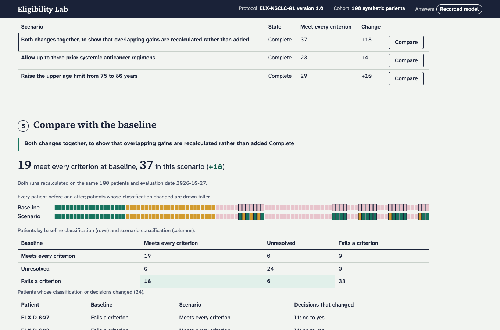

# Eligibility Lab — Muse hackathon, October 2026

Explore how protocol eligibility criteria change a synthetic trial cohort. Review the executable interpretations, inspect the evidence behind each decision, and recalculate membership when an allowed threshold changes.

This repository is a standalone submission for [kitsapublic/2026-10-muse-hackathon](https://github.com/kitsapublic/2026-10-muse-hackathon). It contains the React/TypeScript showcase and reusable components, generated API client, pinned Python engine/service wheel, public synthetic reference bundle and an offline demo. It needs no access to Kitsa's other repositories.



## Try it

Verified on **macOS Apple Silicon, Python 3.11 or 3.14**. The bundled dependency wheels are platform-specific; Linux and Windows have not been verified. No Node, API key or model spend is required to run the prebuilt reference and recorded-model demo.

```sh
cd demo
python3 verify.py
python3 setup.py --venv .venv
.venv/bin/python run.py --store ../recorded-demo-store
```

Open **http://127.0.0.1:8765/**. The ten reference interpretations already carry their retained approvals. Select **Recorded model**, run the baseline, then try the saved scenarios. **Reference** remains available for authored answers. Stop with Control-C; the local store preserves your runs. Setup creates a new environment and does not overwrite one. Recording import requires a fresh store and refuses existing work; repeated starts preserve your runs and review choices.

| Scenario | Meets every criterion | Fails a criterion | Unresolved |
| --- | ---: | ---: | ---: |
| Baseline | 19 | 57 | 24 |
| Upper age 75 → 80 | 29 | 44 | 27 |
| Prior regimens 2 → 3 | 23 | 50 | 27 |
| Both changes | 37 | 33 | 30 |

The combined gain is **18**, rather than the sum of the individual gains (**10 + 4**): patients can fail both criteria. Every interaction runs the engine against the same 100 patient identities and fixed assessment date, 27 October 2026.

## What is implemented

- Closed, validated eligibility rules; three-valued decisions with evidence and explicit missing/conflicting information.
- Deterministic age, date, laboratory-unit and treatment-history calculations.
- Reviewed criterion interpretations; immutable runs; scenario comparison, waterfalls, criterion impact and JSON/CSV exports.
- A loopback service with durable jobs, cancellation/recovery, request identities and a bounded spending ledger.
- Muse Spark 1.3 integration for criterion interpretation and bounded narrative questions. Numeric/date calculations remain deterministic.

**Measured Muse results:** the live demonstration matched all 1,000 criterion decisions and 100 patient classifications in 65.6 seconds. On 40 private synthetic patients, it matched 394/400 criteria and 38/40 classifications, with no false eligibility and two expected passes left unresolved. Narrative agreement was 90.28% on the demonstration and 85.63% on evaluation. These runs used reviewed reference rules; raw model interpretations remain pending review. Read the [benchmark and retained public evidence](docs/BENCHMARK.md).

The bundled demo includes all **391 genuine Muse narrative responses** from the public live baseline. Recorded mode revalidates their exact notes, questions, provider configuration and responses, then reruns the engine. The source run remains identified as evaluator 0.2.4; new runs use 0.2.5. Scenario changes always execute the engine. The launcher removes any inherited model key and never enables live spending. See [verification](docs/VERIFICATION.md) and [architecture](docs/ARCHITECTURE.md).

The fixture is an invented advanced NSCLC protocol with entirely synthetic patients. It is an engineering demonstration, not clinical advice, clinical validation or a system for deciding real patient care. No real patient data, private evaluation cases, model weights, credentials or application database are included.

## Develop the showcase

Requires Node 22+ and npm 11.6.2. Run from the repository root:

```sh
npx npm@11.6.2 ci
npm run typecheck
npm test
npm run check:client
npm run build
```

The engine is installed from `demo/wheelhouse/kitsa_eligibility_lab-0.2.5-py3-none-any.whl`; no engine logic is copied into the frontend. To serve your rebuilt app:

```sh
demo/.venv/bin/eligibility-lab-service serve --store recorded-demo-store --assets apps/showcase/dist
```

For a fresh public-only browser test, with Google Chrome installed:

```sh
ELIGIBILITY_LAB_SERVICE="$PWD/demo/.venv/bin/eligibility-lab-service" \
ELIGIBILITY_LAB_REFERENCE="$PWD/demo/reference" \
ELIGIBILITY_LAB_PORT=8876 sh scripts/run-e2e.sh
```

`apps/showcase` holds the app; `packages/eligibility-ui` holds reusable React components; `packages/eligibility-client` holds the typed client and API schema. `demo/` is the verified prebuilt runtime. `submission-manifest.json` records every retained file's hash and size. The manifest checks integrity; it is not a publisher signature.

Third-party notices are retained under `demo/third-party/` and inside dependency wheels. No general open-source license has yet been selected for Kitsa-authored files. Event eligibility and submission rules remain to be confirmed against the organizer's instructions.

To rerun the portable recording browser check against the running demo (Google Chrome required):

```sh
ELIGIBILITY_LAB_RECORDED_BROWSER=1 ELIGIBILITY_LAB_URL=http://127.0.0.1:8765 \
npm run e2e -w @kitsa/eligibility-lab-showcase -- recorded-flow.spec.ts
```
